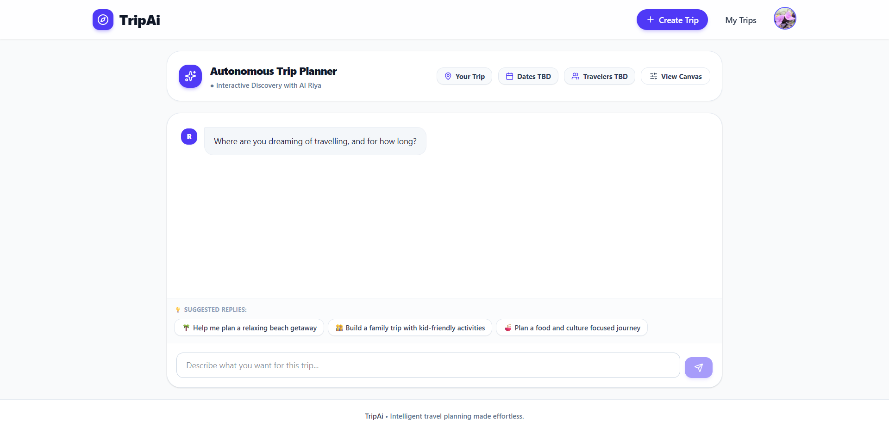

# TripAi — AI Travel Planner

**Plan a trip through conversation, review your requirements, and get a personalised day-by-day itinerary.**

React · TypeScript · FastAPI · LangGraph · OpenAI · PostgreSQL

[Demo](#demo) · [Features](#features) · [Screenshots](#screenshots) · [Architecture](#how-it-works) · [Run locally](#run-tripai-locally) · [Important notes](#important-notes)

## Introduction

Planning a trip usually means comparing places, routes, hotels, and budgets across several websites. TripAi brings those steps into one application.

Its assistant, **Riya**, asks about your destination, dates, budget, interests, and travel preferences. You review the trip summary before generation starts. The planner then researches options and creates an itinerary, while the website shows progress updates.

The project brings together a conversational interface, a multi-agent planning workflow, saved user data, external API integrations, and an interactive itinerary.

## Demo

**[Watch the full walkthrough](docs/assets/tripai-demo.mp4)**

The walkthrough covers trip discovery, confirmation, planning progress, itinerary review, and saved trips. It combines selected workflow screens, a prepared Jaipur sample, and an existing Goa draft; it is **not one uninterrupted completed planning run**.

**Live demo:** Coming soon.

## Features

| Capability | What you can do |
|---|---|
| **Natural conversation** | Describe a trip, answer Riya's follow-up questions, and change requirements. |
| **Personalised plans** | Account for budget, travel pace, must-see places, food preferences, and relevant profile information. |
| **Confirmation before planning** | Review the collected trip details before starting generation. |
| **Live progress updates** | Follow the planner's progress while it researches and builds the itinerary. |
| **Interactive itinerary** | Review the daily timeline, map links, stays, dining suggestions, travel tips, and review notes. |
| **Saved trips and PDF export** | Revisit conversations and plans, or save an itinerary using the browser's print-to-PDF option. |
| **Google sign-in and demo limits** | Access private trips through sign-in, with usage limits to control API consumption. |
| **Public sample trips** | Explore Jaipur, Lonavala, and Paris examples without signing in. |
| **Logging and tracing** | Inspect backend logs and optional LangSmith traces for troubleshooting. |

## Screenshots

<details>
<summary><strong>Landing page and public sample trips</strong></summary>


</details>

<details>
<summary><strong>Trip discovery with Riya</strong></summary>



</details>

<details>
<summary><strong>Traveler profile, preferences, and demo usage</strong></summary>


Email and phone details have been redacted for publication. The remaining interface is unchanged.

</details>

### Public sample trips

The sample trips use the same itinerary interface as real plans. They are generated examples that were subsequently reviewed and simplified; opening them does not make a new model call.

| Sample | Local route |
|---|---|
| Jaipur heritage weekend | `/examples/jaipur-heritage` |
| Lonavala family road trip | `/examples/lonavala-family` |
| Paris art and culture | `/examples/paris-culture` |

## How it works

```text
Describe the trip → Answer follow-up questions → Confirm the summary
       → Research and plan → Review the itinerary → Save or export
```

The application has two main workflows:

1. **Trip discovery:** Riya collects the requirements, updates trip memory, answers questions, and prepares a confirmation summary.
2. **Itinerary planning:** a supervisor coordinates destination research, itinerary planning, accommodation research, transport research, and response aggregation. The backend validates the structured results and saves the plan.

[](docs/assets/tripai-architecture.png)

[Open the full-resolution architecture diagram](docs/assets/tripai-architecture.png).

The backend streams progress to the browser using **Server-Sent Events (SSE)**. PostgreSQL stores users, conversations, trip requirements, and saved plans.

## Technology stack

| Area | Tools |
|---|---|
| Frontend | React, TypeScript, Vite, Tailwind CSS |
| Backend | Python 3.11, FastAPI, PydanticAI |
| AI workflow | LangGraph, OpenAI |
| Database | PostgreSQL / Neon |
| Authentication | Google Identity Services |
| Travel data | Google Maps/Places, OpenRouteService, weather and currency adapters |
| Monitoring | Structured logs, LangSmith |
| Build and packaging | Docker, Docker Compose, Caddy, GitHub Actions |

## Run TripAi locally

Run commands from the repository root unless a different directory is shown.

### Prerequisites

| Requirement | Purpose |
|---|---|
| Neon/PostgreSQL database | Store users, conversations, trip requirements, and saved plans. |
| Google OAuth web client ID | Enable Google sign-in. |
| OpenAI, Google Maps/Places, and OpenRouteService keys | Enable live planning and provider integrations. |
| Docker Desktop | Run the container setup. |
| Python 3.11 and Node.js 22 | Run the development setup. |

### One-time settings

Create `backend/.env` from `backend/.env.example`. Add the database URL, Google client ID, OpenAI key, Maps key, and route key using the variable names in the example file. Set:

```dotenv
PLANNING_ENABLED=true
RIYA_AUTO_MIGRATE=false
```

For Google sign-in, add the appropriate local website address to the OAuth client's **Authorized JavaScript origins**:

| Setup | Authorized JavaScript origin |
|---|---|
| Containers | `http://localhost:8080` |
| Development servers | `http://localhost:5173` |

**Database safety:** Neon runs outside this repository and outside Docker. Put its connection string in `DATABASE_URL`. **If you are using the existing TripAi database, do not run any database setup command.** For a brand-new isolated database only, run `python -m app.db init` from `backend/` after adding its connection details.

Keep all secrets in `backend/.env`. The frontend only needs the public Google client ID in `frontend/.env` as `VITE_GOOGLE_CLIENT_ID`; use `VITE_API_BASE=http://127.0.0.1:8000` when running the development servers.

### Run with containers

Create `deploy/.env` from `deploy/.env.example`, set `GOOGLE_OAUTH_CLIENT_ID` to the same public Google client ID, and leave `BACKEND_ENV_FILE=backend/.env`.

```bash
docker compose --env-file deploy/.env -p tripai-local up -d --build --wait --wait-timeout 180
```

Open **http://localhost:8080**. The frontend, backend, and Caddy web server start together; Neon remains external.

To confirm the app is ready without creating a trip:

```bash
python deploy/smoke.py --url http://localhost:8080 --ready
```

### Run during development

Start the backend in one terminal:

```powershell
cd backend
python -m venv .venv
.venv/Scripts/python.exe -m pip install -r requirements.lock
.venv/Scripts/python.exe -m uvicorn app.main:create_app --factory --host 127.0.0.1 --port 8000
```

Start the website in a second terminal:

```powershell
cd frontend
npm ci
npm run dev
```

Open **http://localhost:5173**. On Linux or macOS, use the equivalent `python3`, virtual-environment, and shell commands.

## Checks and deployment

| Command | Run from |
|---|---|
| `npm run lint` | `frontend/` |
| `npm run build` | `frontend/` |
| `ruff check app scripts` (install Ruff first) | `backend/` |
| `python deploy/smoke.py --url http://localhost:8080 --ready` | Repository root |

GitHub Actions checks lint, builds, dependencies, and container startup. **Deployment automation is not connected yet.** The current Docker setup runs the frontend and backend together, with Neon hosted separately.

For deployment, use a Docker-capable Linux host, keep `backend/.env` only on that host, add your real domain to Google OAuth, and run the same Compose command with the production environment values.

## Important notes

- **Planning drafts, not confirmed bookings:** verify prices, availability, opening hours, and important travel details before booking.
- **Research only:** accommodation and transport tools research options; they do not make reservations or payments.
- **One backend worker:** live events and active planning tasks run inside one process. Restarting it can interrupt an active plan.
- **Reviewed examples:** public samples are snapshots rather than fresh searches.
- **Provider dependencies:** live planning depends on provider access, coverage, and API limits.
