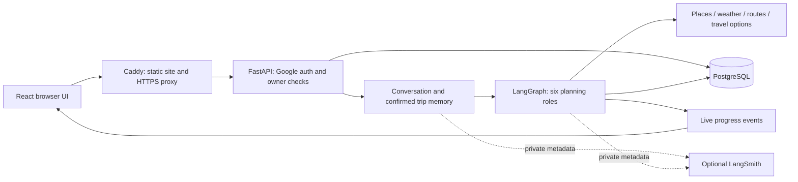

# TripAi

TripAi turns a conversation with **Riya** into a personalized travel itinerary.
It collects and confirms trip requirements, researches places and travel options,
builds a day-by-day plan, and displays progress while the work runs in the background.

## What the app demonstrates

- Conversational requirement collection, corrections and confirmation before planning.
- Six planning roles coordinated through LangGraph, with typed tools and bounded model requests.
- Day-by-day itinerary, maps and stops, stays and dining, travel tips and review notes.
- Google sign-in, owner-protected trips, persistent chat and saved plans.
- Demo allowances with an administrator-controlled full-access setting.
- Three public, read-only examples that load without signing in or starting a model call.
- Structured logs and optional LangSmith tracing with conversation/profile text hidden.

The public examples are reviewed snapshots. They are not fresh provider searches.
Prices, availability, opening hours and uncertain travel details remain labelled for review.
The transport agent researches options; it does not book tickets or charge users.

## Quick start: local containers

Requires Docker with **Linux containers**, Docker Compose **2.24.4 or newer**, and
Python 3.11+ on the host for the small setup/check scripts. On Windows, start Docker Desktop.
Run these commands from the repository root:

```powershell
if (-not (Test-Path deploy/.env)) { Copy-Item deploy/.env.example deploy/.env }
# Set the public Google client ID in deploy/.env.
# BACKEND_ENV_FILE points to your existing ignored backend/.env.
docker compose --env-file deploy/.env -p tripai-local up -d --build --wait --wait-timeout 180
python deploy/smoke.py --url http://localhost:8080 --ready
```

Open **http://localhost:8080**. On Linux/macOS, use `cp` to copy the template only
when `deploy/.env` does not exist. This setup reuses your existing Neon database,
schema and API keys. It never starts a database container or runs migrations.
The smoke command checks public routes and database readiness without model calls
or writes. Starting a chat or plan yourself uses your normal API allowance.
For local Google login, authorize the chosen localhost port in Google Cloud.

For normal development with real chat/planning, see [Local development](docs/local-development.md).
For future server deployment, see [Deployment](docs/deployment.md).

## Repository map

```text
backend/
  app/api/              Authentication, trips, profile, health and request limits
  app/collection/       Riya's conversation, extraction and confirmation flow
  app/itinerary/        Planning graph, six roles, validation and saved-plan display
  app/planning_tools/   Places, routes, weather and booking-option research
  app/providers/        HTTP clients and the bounded model/tool loop
  app/services/         Progress events, usage limits, logs and tracing
  app/db/               PostgreSQL repository and explicit schema setup
  app/models/           Shared data contracts
  scripts/              Sample builds and tracing checks
  samples/              Reviewed anonymous sample inputs and photo metadata
frontend/
  src/pages/            Landing, trip chat, examples, saved trips and profile
  src/components/       Shared itinerary canvas and reusable UI
  src/lib/              API access, chat reconciliation and plan presentation
deploy/                 Runtime templates and a read-only HTTP smoke check
.github/workflows/      Build, lint, audit and container-startup checks
docs/                   Setup, architecture and operations guidance
```

## Architecture



The backend currently runs **one worker**: its event bus and active background tasks
are process-local. PostgreSQL stores durable chat, plans and job status. Multi-worker
or multi-server execution needs shared event/job coordination and is outside this MVP.

## Useful checks

| Command | What it checks |
|---|---|
| `npm run lint` in `frontend/` | Frontend code quality |
| `npm run build` in `frontend/` | TypeScript and production bundle |
| `ruff check app scripts` in `backend/` | Backend code quality |
| `python scripts/check_observability.py` in `backend/` | Synthetic LangSmith delivery, no model call |
| `python deploy/smoke.py --url <website-origin> --ready` | Public routes, denied anonymous trip access and readiness |

The development regression suite is maintained outside this repository. CI includes
the committed build, dependency and container-startup checks; it does not claim to run
that external suite or validate itinerary quality against live providers.

## Before publishing or deploying

Keep `.env` files, passwords, API keys, private chats, database dumps and local logs
outside Git and Docker images. Frontend `VITE_` values are public browser configuration.
Review the full Git history before making the repository public and rotate any exposed key.

GitHub Actions currently checks builds only. Connect deployment to the chosen host
later; merely pushing these files does not deploy. Neon and the provider settings
stay as they are, and secrets are supplied at container runtime.
See [Operations](docs/operations.md), [Architecture decisions](docs/decisions/0001-single-server-deployment.md)
and [Third-party resources](docs/third-party-resources.md).
The local acceptance record is in [Verification](docs/verification.md).
