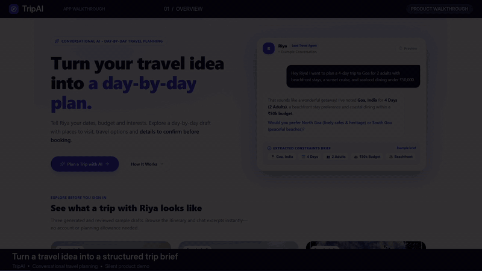
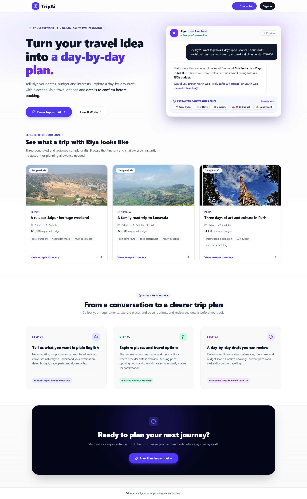
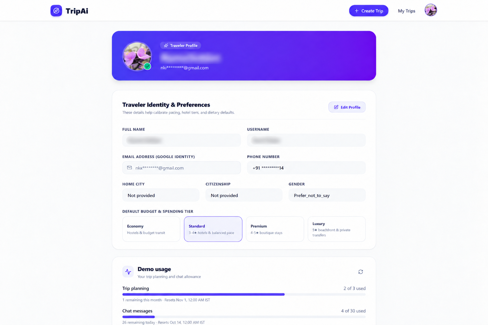
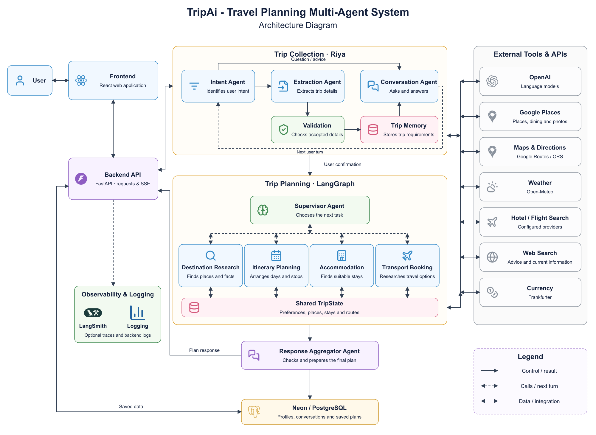

# TripAi — AI Travel Planner

Plan a trip through conversation, confirm your requirements, and explore a personalised day-by-day itinerary.

[](https://github.com/Nishant1998/Trip_Planner/actions/workflows/ci.yml)


[Demo](#demo) · [Features](#features) · [Architecture](#architecture) · [Setup](#setup) · [Deployment](#deployment)

TripAi brings trip discovery, travel research, and itinerary planning into one application. Its assistant, **Riya**, asks about your destination, dates, budget, and preferences. After you confirm the summary, the backend coordinates planning agents and shows progress as your itinerary takes shape.

## Demo

<p align="center">
  
</p>

*Complete walkthrough showing conversational discovery with Riya, confirmation card gating, real-time agent planning progress, and the interactive itinerary canvas.*

<details>
<summary>More screenshots</summary>

**Landing page and public examples**



**Traveler profile and usage**



</details>

## Features

- **Conversational planning:** describe a trip, answer follow-up questions, and change the details before confirming.
- **Personalised itineraries:** account for budget, pace, interests, must-see places, dietary needs, and profile preferences.
- **Live progress:** see updates while the planner researches places, travel options, and accommodation.
- **Itinerary workspace:** explore the timeline, place photos, Google Maps links, stays, dining, packing tips, and review notes.
- **Saved trips and PDF export:** return to previous conversations and plans, or save an itinerary through print-to-PDF.
- **Google sign-in and usage limits:** access personal trips and see the remaining demo allowance on the profile page.
- **Public examples:** browse Jaipur, Lonavala, and Paris itineraries without signing in or starting a new model request.

## How to use

1. **Explore an example:** open a sample itinerary from the landing page without signing in.
2. **Plan your own trip:** sign in with Google, select **Create Trip**, and tell Riya your destination, dates, budget, and preferences. Review the collected details before starting planning.
3. **Review the result:** follow the progress updates, explore your itinerary, and check the review notes before making bookings. Revisit saved trips from **My Trips** or export a PDF.

## Architecture

<p align="center">
  <a href="docs/assets/tripai-architecture.png">
    
  </a>
</p>

**Collect → Confirm → Research and plan → Validate → Save and display**

The collection workflow turns the conversation into structured trip requirements. A LangGraph supervisor coordinates destination research, itinerary planning, accommodation, transport, and response aggregation. Python validators check the combined output, PostgreSQL stores the result, and FastAPI streams progress to the frontend through Server-Sent Events (SSE).

### Implementation highlights

- **Controlled planning:** [confirmation checks](backend/app/collection/confirmation_gate.py), [typed state and bounded agent routing](backend/app/itinerary/graph.py), and [plan validation](backend/app/itinerary/validation.py) keep the workflow tied to the user's requirements.
- **Route comparison:** [OR-Tools CP-SAT](backend/app/planning_tools/route_optimizer.py) compares cheapest, balanced, and fastest options. The planner uses supplied connections and an allocated city order; unknown prices stay explicit.
- **Reliable job handling:** [snapshot-based jobs](backend/app/itinerary/store.py), [chat idempotency](backend/app/db/migrations/002_chat_idempotency.sql), and [database-backed allowances](backend/app/services/demo_usage.py) limit duplicate work and API consumption.
- **Observability:** [structured logs](backend/app/services/logging.py) and optional [LangSmith traces](backend/app/services/tracing.py) capture operational metadata without sending conversation content through the explicit tracing integration.
- **Build checks:** [GitHub Actions](.github/workflows/ci.yml) runs lint, frontend builds, dependency audits, and container startup checks. Docker packages the app behind Caddy.

## Tech stack

| Area | Technologies |
|---|---|
| Frontend | React, TypeScript, Vite, Tailwind CSS, TanStack Query |
| Backend | Python 3.11, FastAPI, PydanticAI, Pydantic |
| AI and planning | OpenAI, LangGraph, OR-Tools |
| Database and auth | PostgreSQL / Neon, Psycopg, Google Identity Services |
| Travel data | Google Places / Routes, OpenRouteService, Open-Meteo, Frankfurter; optional Bright Data providers |
| Operations | Docker, Caddy, GitHub Actions, structured logs, LangSmith |

## Setup

You need a PostgreSQL database, a Google OAuth web client ID, and API credentials for live planning. Configure the environment first, then choose **Container setup** (Docker Compose) or **Development servers** (Python 3.11 and Node.js 22).

```bash
git clone https://github.com/Nishant1998/Trip_Planner.git
cd Trip_Planner
```

<details>
<summary><strong>Configuration — required for either setup</strong></summary>

Create `backend/.env` from [the example](backend/.env.example). Add your credentials and choose model IDs available to your OpenAI account:

```dotenv
DATABASE_URL=your-postgresql-connection-string
RIYA_DATABASE_SCHEMA=trip_planner_dev
RIYA_AUTO_MIGRATE=false
OPENAI_API_KEY=your-api-key
OPENAI_CHAT_MODEL=your-chat-model
OPENAI_MODEL=your-planning-model
RIYA_AUTH_MODE=google
GOOGLE_OAUTH_CLIENT_ID=your-client-id.apps.googleusercontent.com
GOOGLE_MAPS_API_KEY=your-maps-key
ORS_API_KEY=your-openrouteservice-key
PLANNING_ENABLED=true
CORS_ORIGINS=http://localhost:5173,http://127.0.0.1:5173
```

Use the SSL settings supplied with your Neon connection string. Enable the required Google Places and Routes APIs. Provider calls may incur charges; optional flight and hotel research needs additional [Bright Data configuration](backend/app/planning_tools/catalog.py).

In Google Cloud, add your frontend address to the OAuth client's **Authorized JavaScript origins**: `http://localhost:8080` for containers or `http://localhost:5173` for development. Add `http://127.0.0.1:5173` if you use that address too.

For optional tracing, set `TRIPAI_TRACING_ENABLED=true`, `LANGSMITH_API_KEY`, and `LANGSMITH_PROJECT=TripAi`. Leave automatic `LANGSMITH_TRACING` and `LANGCHAIN_TRACING_V2` disabled; the app exports its own metadata-only spans.

</details>

<details>
<summary><strong>Container setup</strong></summary>

Create `deploy/.env` from [the example](deploy/.env.example). Set the same `GOOGLE_OAUTH_CLIENT_ID` and keep `BACKEND_ENV_FILE=backend/.env`.

For a **new, empty database only**, initialise the schema:

```bash
docker compose --env-file deploy/.env -p tripai-local build backend
docker compose --env-file deploy/.env -p tripai-local run --rm backend python -m app.db init
```

Start the application:

```bash
docker compose --env-file deploy/.env -p tripai-local up -d --build --wait --wait-timeout 180
```

Open **http://localhost:8080**. Caddy serves the frontend and forwards API requests to the backend. Neon remains external.

```bash
# View backend logs
docker compose --env-file deploy/.env -p tripai-local logs -f backend

# Stop the application
docker compose --env-file deploy/.env -p tripai-local down
```

After changing application code, rerun the startup command with `--build`.

</details>

<details>
<summary><strong>Development servers</strong></summary>

Create `frontend/.env` from [the example](frontend/.env.example). Set `VITE_GOOGLE_CLIENT_ID` to the backend's client ID and `VITE_API_BASE=http://127.0.0.1:8000`. Keep API secrets in the backend environment file.

Start from the repository root. In the first terminal:

```powershell
cd backend
python -m venv .venv
.venv/Scripts/python.exe -m pip install -r requirements.lock
```

For a **new, empty database only**, run `.venv/Scripts/python.exe -m app.db init`. Then start FastAPI:

```powershell
.venv/Scripts/python.exe -m uvicorn app.main:create_app --factory --host 127.0.0.1 --port 8000 --reload
```

In a second terminal, starting from the repository root:

```bash
cd frontend
npm ci
npm run dev
```

Open **http://localhost:5173**. On macOS or Linux, create the environment using `python3` and replace `.venv/Scripts/python.exe` with `.venv/bin/python`.

</details>

### Checks

| Command | Run from |
|---|---|
| `npm run lint` | `frontend/` |
| `npm run build` | `frontend/` |
| `ruff check app scripts` | `backend/`; install Ruff in the virtual environment first |
| `python -m app.db check` | `backend/`, using its virtual environment |
| `python deploy/smoke.py --url http://localhost:8080 --ready` | Repository root, with the container app running; requires Python |

The smoke check verifies routes, assets, anonymous-access protection, and readiness. It does not generate a trip or test live itinerary quality.

## Deployment

The [production Compose override](compose.production.yaml) runs the frontend and backend on one Linux host behind Caddy, with Neon hosted separately. GitHub Actions currently provides CI checks; server deployment is not automated.

<details>
<summary><strong>Server configuration and startup</strong></summary>

Use Docker Compose v2.24.4 or newer. Keep `backend/.env` on the server, point your domain to its IP address, and allow inbound ports 80 and 443. Set these values in `deploy/.env`:

```dotenv
BACKEND_ENV_FILE=backend/.env
GOOGLE_OAUTH_CLIENT_ID=your-client-id.apps.googleusercontent.com
PUBLIC_ORIGIN=https://tripai.example.com
SITE_ADDRESS=tripai.example.com
```

Replace the example domain and add the HTTPS origin to Google OAuth. Initialise the schema only if using a new, empty database, then run:

```bash
docker compose --env-file deploy/.env -p tripai -f compose.yaml -f compose.production.yaml up -d --build --wait --wait-timeout 180
```

Caddy handles HTTPS for the configured domain. Keep environment files out of Git.

</details>

## Important notes

- Itineraries are planning drafts. Verify prices, availability, opening hours, and schedules before booking; the app does not make reservations or payments.
- Live results and photos depend on provider coverage. Public sample trips are saved examples rather than fresh searches.
- Run one backend worker: planning tasks and SSE subscriptions are process-local, and a restart can interrupt an active plan.
